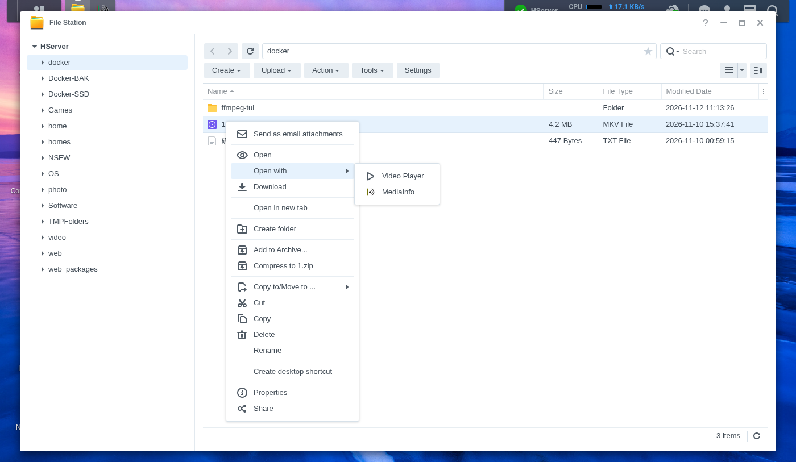
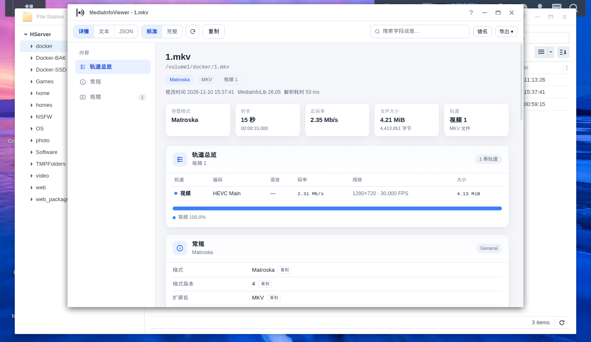
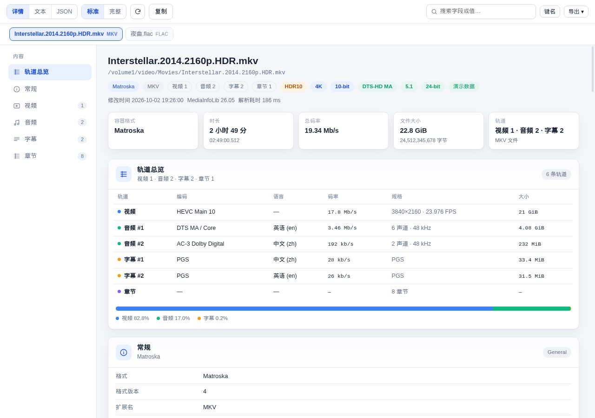
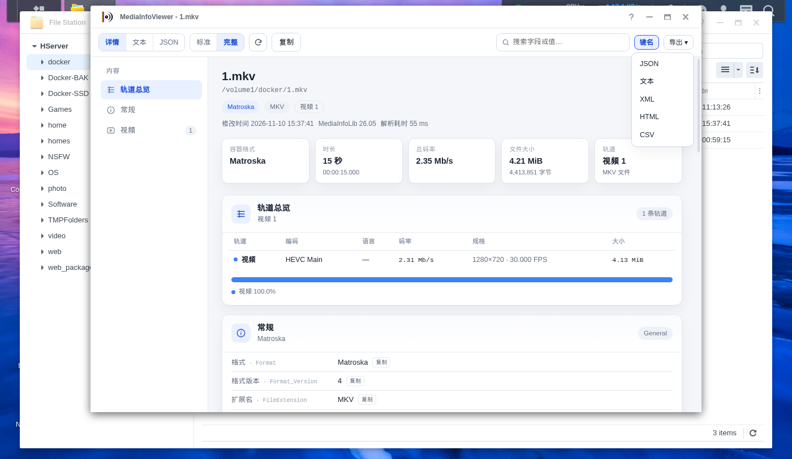
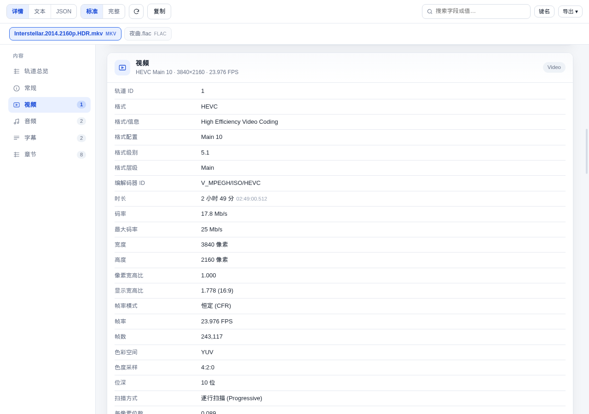
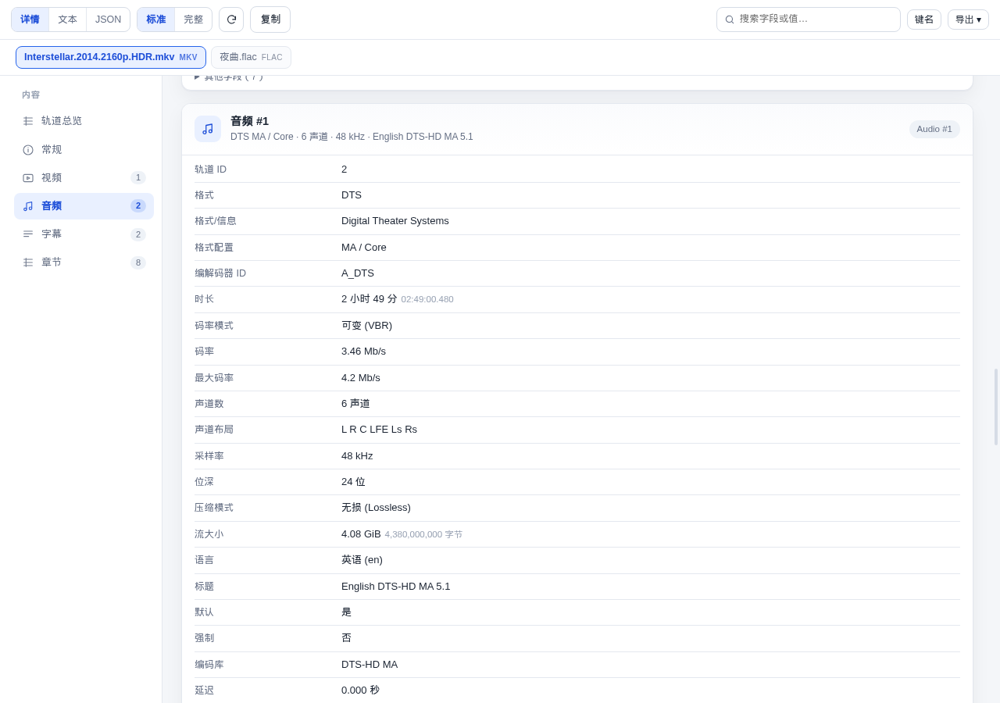
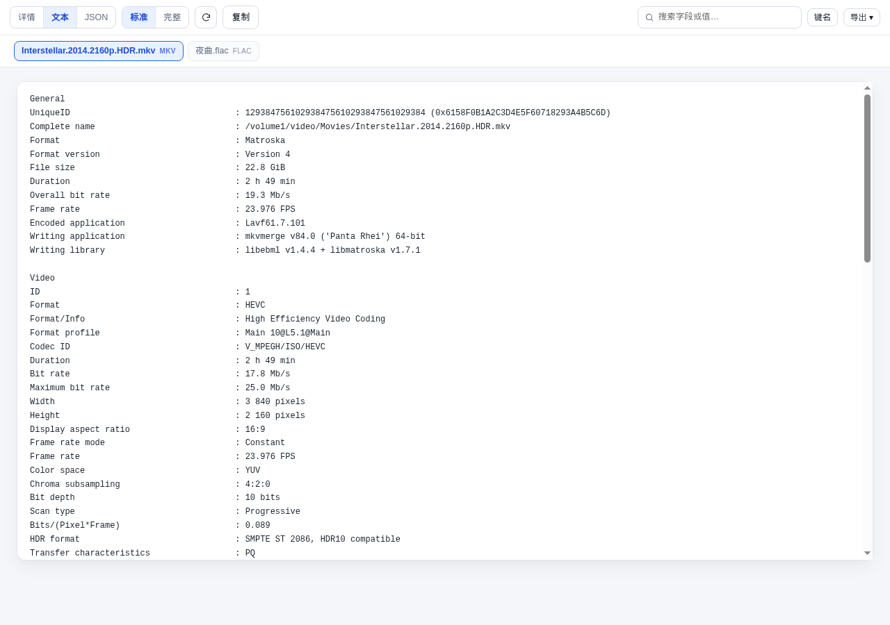

# MediaInfoViewer（MediaInfo查看器）

> 在 Synology DSM File Station 中右键查看音视频文件的 MediaInfo 技术信息。

[GitHub 仓库](https://github.com/MeowPerth/MediaInfoViewer-DSM) ·
[问题反馈](https://github.com/MeowPerth/MediaInfoViewer-DSM/issues) ·
[v1.0.0 Release](https://github.com/MeowPerth/MediaInfoViewer-DSM/releases/tag/v1.0.0)



在 File Station 中右键点击音频/视频文件，选择 **打开 → MediaInfo**，即可在群晖原生窗口中查看封装、视频、音频、字幕、章节等完整技术信息。



## 功能

- **File Station 右键菜单**：位于「打开 → MediaInfo」，与 Video Player、Text Editor 并列
- **单窗口多标签**：连续打开多个文件时复用同一个窗口，标签页切换，窗口标题跟随当前文件
- **标准 / 完整模式**：完整模式使用 `mediainfo --Full`，展示全部内部字段
- **字段搜索**：按字段名、显示值或 MediaInfo 原始键名实时过滤，并显示匹配数量
- **轨道总览**：一屏对比所有轨道的编码、语言、码率、分辨率/声道、流大小，并显示
  视频/音频/字幕的流大小占比条
- **HDR / 音频徽章**：HDR10、HDR10+、Dolby Vision、4K/8K、10-bit、DTS-HD MA、
  Dolby Atmos、DTS:X、5.1/7.1、96 kHz、24-bit 等
- **字段复制 / 键名显示**：悬停字段可复制原始值；「键名」按钮显示 `Format_Profile`
  这类 MediaInfo 原始键
- **文本视图 / JSON 视图**：MediaInfo 原生文本输出与完整原始 JSON
- **导出**：JSON / 文本 / XML / HTML / CSV（后三种为 MediaInfo 原生输出）
- 深色模式跟随系统
- 只读操作，以当前 DSM 用户身份解析文件，不绕过 File Station 权限

## 截图

### 轨道总览与 HDR/音频徽章



### 完整模式、键名与导出



### 视频 / 音频 / 文本视图







## 前置条件

- **DSM 7.1-42661 或更高版本**（在 DSM 7.4.0-90075 / SA6400 上测试）
- **x86_64** 架构（`epyc7002 x86_64` 构建）
- **必须安装 SynoCommunity 的 MediaInfo 套件**，提供
  `/var/packages/mediainfo/target/bin/mediainfo`
  - 套件 `INFO` 已声明 `install_dep_packages="mediainfo"`
  - 安装前检查脚本会再次确认 `mediainfo` 命令行存在；缺失时拒绝安装并提示先安装 MediaInfo
- DSM 自带 `python3`
- 套件未签名，安装时需要在「套件中心 → 设置 → 常规」允许「任何发行者」或先导入信任

## 安装

1. 在套件中心确认已安装 **MediaInfo**（SynoCommunity）。
2. 套件中心 → **手动安装** → 选择
   `dist/mediainfo-fs_x86_64-dsm7_1.0.0.spk`。
3. 安装完成后等待几秒，让套件自动启动，然后 **刷新 File Station**
   （Ctrl+F5，或关闭窗口重新打开）。

命令行安装（可选）：

```bash
sudo synopkg install mediainfo-fs_x86_64-dsm7_1.0.0.spk
```

> 本套件是纯 UI 套件，没有常驻服务。安装脚本会创建一个 enabled 标记，并通过一个
> 一次性 systemd timer 调用 `synopkg start mediainfo-fs`，让 File Station
> 将其识别为已启动并加载右键菜单；重启后 timer 会再次启动套件。

### 菜单没有出现？

1. 刷新 File Station（Ctrl+F5）；
2. 确认 `/var/packages/mediainfo-fs/enabled` 存在；
3. 执行一次 `sudo synopkg start mediainfo-fs` 后刷新；
4. 查看日志：`/var/log/packages/mediainfo-fs.log`。

## 使用

1. 打开 File Station，进入包含媒体文件的目录。
2. 右键点击 `.mkv` / `.mp4` / `.mp3` / `.flac` 等音视频文件。
3. 选择 **打开 → MediaInfo**。
4. 在窗口中：
   - 顶部切换 **详情 / 文本 / JSON**
   - 使用 **标准 / 完整** 切换信息量
   - 使用搜索框过滤字段
   - 「键名」显示原始键名
   - 「导出」导出 JSON / 文本 / XML / HTML / CSV
   - 字段悬停显示「复制」，复制原始值
5. 再次打开其他文件会追加到同一窗口的标签页，窗口标题随当前标签更新。

## 实现结构

```
src/
├── ui/
│   ├── config           # DSM UI 注册 + fb_extern（File Station 右键菜单）
│   ├── dsm-wrapper.js   # FBExt / AppInstance / AppWindow / 单窗口标签
│   ├── index.html       # 查看器页面
│   ├── app.css
│   ├── app.js           # 字段渲染、搜索、总览、徽章、导出
│   ├── api.cgi          # 认证 + 路径校验 + 降权 + mediainfo
│   └── demo.json
├── bin/
│   └── enable.c         # setuid helper：enabled 标记 + 自启动 timer
spk/
├── INFO
├── conf/privilege       # api.cgi root；enable helper setuid root
├── scripts/
└── WIZARD_UIFILES/
```

### File Station 菜单

`ui/config` 的应用配置声明：

```json
"fb_extern": [{
  "multiple": true,
  "dir": false,
  "iconCls": "mediainfo-menu-icon",
  "text": "MediaInfo",
  "inMenu": "gc_view",
  "checkFn": "MeowPerth.MediaInfoFS.FBExt.checkFn",
  "launchFn": "MeowPerth.MediaInfoFS.FBExt.launchFn"
}]
```

`checkFn` 使用 File Station 记录的 `real_path`（如 `/volume1/docker/1.mkv`）。
`launchFn` 复用一个 `AppInstance` 窗口，并通过 `postMessage` 向 iframe 追加标签，
标签切换时由页面通知父窗口更新标题。

### 后端 CGI

`ui/api.cgi` 由 DSM 的 `synoscgi` 执行；`conf/privilege` 把它设为 `root:package 0755`，
因此以 root 启动。每个请求：

1. 用 `authenticate.cgi` 校验 DSM 会话，并校验 `SynoToken`；
2. 校验路径必须在 `/volume*` 下且为普通文件；
3. `setgroups` / `setgid` / `setuid` 切换到当前登录的 DSM 用户；
4. 以该用户身份执行 `mediainfo`。

文件权限、ACL、共享文件夹权限与 File Station 完全一致。MediaInfo 26.05 对非 ASCII
路径存在打开问题，后端会临时创建 ASCII 符号链接解析，并在输出中替换回真实路径。

### 自启动

File Station 只加载「已启动」套件的 `fb_extern`。纯 UI 套件没有常驻进程，安装脚本
（以 `sc-mediainfo-fs` 运行）无法调用 `synopkg`。`bin/mediainfo-fs-enable` 是仅接受
固定参数的 setuid helper：

- 创建 `/var/packages/mediainfo-fs/enabled`
- 写入并启用一个一次性 systemd timer，2 秒后执行 `synopkg start mediainfo-fs`
- 卸载时由 `preuninst` 调用 helper 删除 timer

## 安全说明

- 不以 root 读取用户文件：`api.cgi` 在调用 MediaInfo 前完成降权。
- 不使用 shell 拼接路径；文件路径作为 argv 传递。
- 路径限制在 `/volume*`，要求普通文件。
- 临时符号链接位于 `/tmp`，随机文件名，使用后删除。
- `mediainfo-fs-enable` 仅执行固定路径/固定命令，不是通用 root shell。
- 套件未签名；请只安装来自本仓库的 SPK。

## 构建

```bash
bash build.sh
# 产物：dist/mediainfo-fs_x86_64-dsm7_1.0.0.spk
```

构建机需要 `bash`、`python3`、`node`、`gcc`（编译静态 setuid helper）。

## 已知限制

- 仅提供 x86_64（`epyc7002 x86_64`）构建。
- 必须安装 SynoCommunity 的 MediaInfo 套件。
- 纯 UI 套件通过一次性 timer 启动；安装/重启后请等待数秒并刷新 File Station。
- 一次最多打开 20 个文件。
- 窗口由 `AppInstance` 创建，不提供任务栏常驻按钮，使用窗口右上角关闭。
- 非 ASCII 文件名通过临时符号链接解析。

## 版本

当前版本：**v1.0.0**（首个公开发布版）

## 许可

MIT。MediaInfo 名称与 Logo 属于 MediaArea.net（BSD-2-Clause）；本套件不重新分发
MediaInfo 本体，只调用用户已安装的 MediaInfo 命令行工具。

---

项目地址：<https://github.com/MeowPerth/MediaInfoViewer-DSM>
