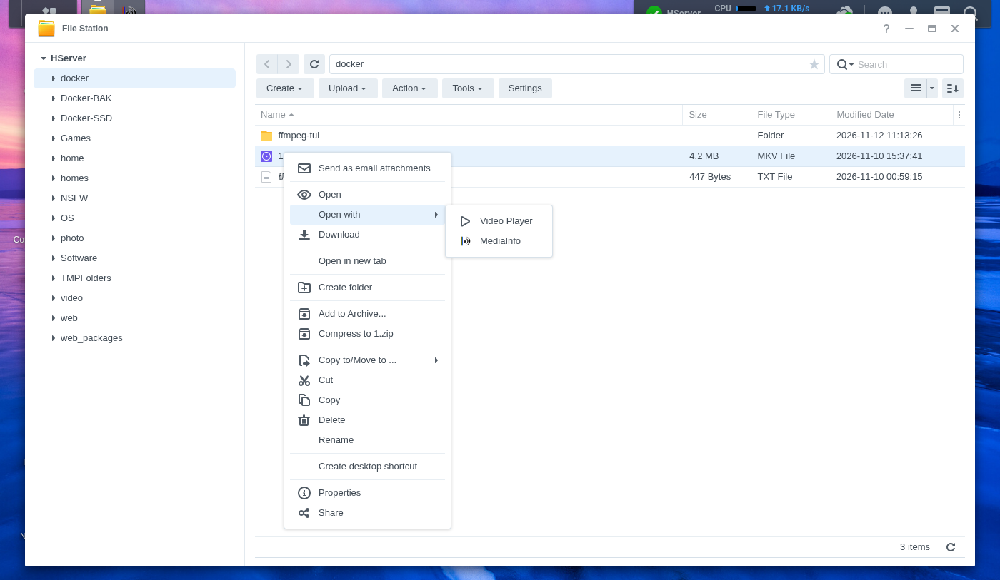
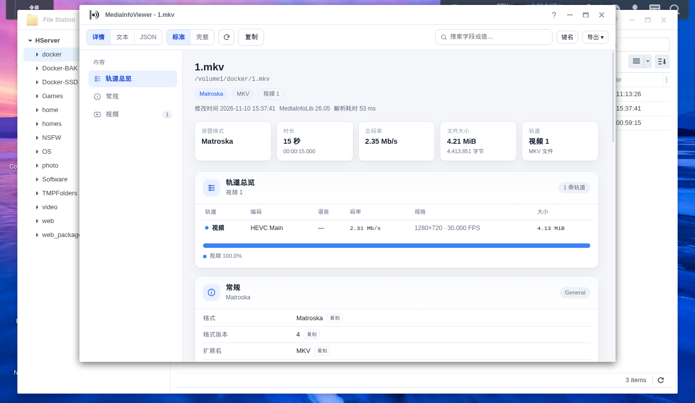
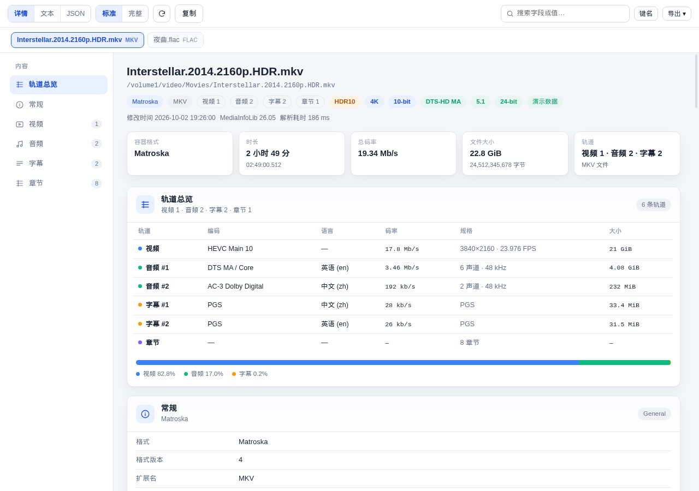
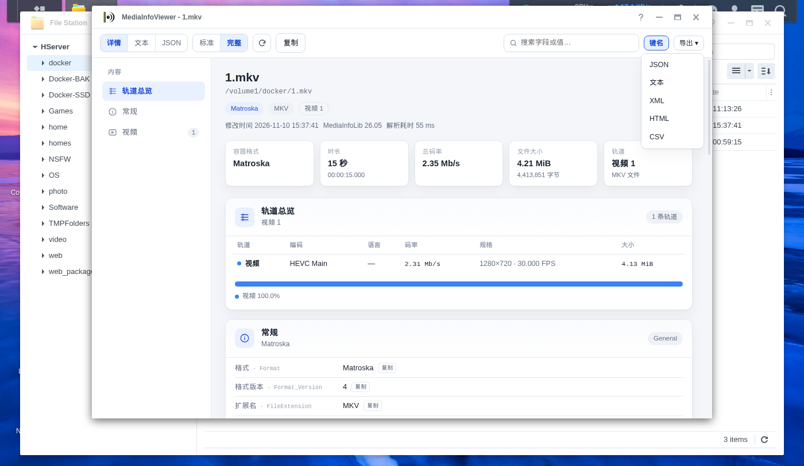

# MediaInfoViewer v1.0.0

**MediaInfoViewer（MediaInfo查看器）首个公开发布版。**

在 Synology DSM 7 的 **File Station 右键菜单**中直接查看音视频文件的 MediaInfo 技术信息：

- 右键 → **打开 → MediaInfo**
- 群晖原生窗口，支持最小化 / 最大化 / 关闭 / 拖动
- 多个文件在同一个窗口内以标签页查看，标题跟随当前标签





## 功能

- **标准 / 完整模式**：完整模式使用 `mediainfo --Full`，展示全部内部字段
- **字段搜索**：按字段名、显示值或原始键名过滤，显示匹配数量
- **轨道总览**：所有轨道一屏对比，并显示视频/音频/字幕流大小占比条
- **HDR / 音频徽章**：HDR10、HDR10+、Dolby Vision、4K/8K、10-bit、DTS-HD MA、
  Dolby Atmos、DTS:X、5.1/7.1、96 kHz、24-bit 等
- **字段复制 / 键名显示**：悬停字段复制原始值；「键名」显示 `Format_Profile` 等原始键
- **文本 / JSON 视图**
- **导出**：JSON / 文本 / XML / HTML / CSV
- **多文件标签页**、深色模式
- 以当前 DSM 用户身份读取，权限与 File Station 一致





## 前置条件

- DSM **7.1-42661** 或更高版本（测试于 DSM 7.4.0-90075 / SA6400）
- **x86_64**（`epyc7002 x86_64` 构建）
- 必须安装 **SynoCommunity MediaInfo** 套件；套件已声明依赖并会在安装前检查
  `mediainfo` 命令行

## 安装

1. 先在套件中心安装 **MediaInfo**（SynoCommunity）。
2. 下载下方 `mediainfo-viewer_x86_64-dsm7_1.0.0.spk`，在套件中心手动安装。
3. 等待几秒，然后刷新 File Station（Ctrl+F5）。

```bash
sudo synopkg install mediainfo-viewer_x86_64-dsm7_1.0.0.spk
```

## 链接

- 源码与文档：https://github.com/MeowPerth/MediaInfoViewer-DSM
- 使用说明：https://github.com/MeowPerth/MediaInfoViewer-DSM#readme
- 问题反馈：https://github.com/MeowPerth/MediaInfoViewer-DSM/issues

## 许可

MIT。MediaInfo 名称与 Logo 属于 MediaArea.net；套件不重新分发 MediaInfo 本体。
